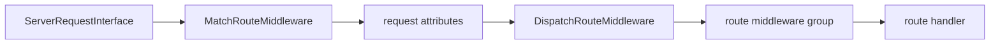

# Componenta Router

Requires PHP 8.5.13 or newer, Componenta Config 4, DI 6, HTTP Responder 2 and Middleware Factory 3.

Runtime HTTP router for Componenta applications. The package provides immutable route records, fluent route building, route groups, route collections, path pattern compilation, optimized compiled routes, URL generation, PSR-15 route matching and dispatch middleware, handler resolution, and router exception handlers.

Attribute discovery, production route-cache generation, and HTTP-interceptor route handler resolution live in `componenta/router-app`.

## Installation

```bash
composer require componenta/router
```

## Package Boundaries

`componenta/router` owns runtime routing behavior. It can work with explicitly registered routes and does not require class scanning.

## Related Packages

| Package | Why it matters here |
|---|---|
| `componenta/http-responder` | Provides HTTP response helpers; router only selects handlers and does not format controller output. |
| `componenta/middleware-factory` | Turns strings, classes, groups, and middleware instances into `MiddlewareInterface`. |
| `componenta/di` | Creates route handlers and middleware from the container when needed. |
| `componenta/router-app` | Discovers `#[Route]` attributes, builds route cache files, and provides application HTTP-interceptor route handler resolution. |

Use `componenta/router` for:

- route records and route collections;
- route matching and URL generation;
- grouped routes and middleware groups;
- PSR-15 matching/dispatch middleware;
- compiled route collections loaded from cache;
- route exception handling.

Use `componenta/router-app` for:

- discovering `#[Route]` attributes;
- generating route cache files;
- integrating route compilation with the application cache pipeline;
- resolving route handlers through HTTP interceptors.

## Route Records

`RouteRecord` is an immutable route definition.

```php
use Componenta\Http\Router\RouteRecord;

$route = RouteRecord::get(
    name: 'posts.show',
    path: '/posts/{id}',
    handler: ShowPostController::class,
    middlewares: ['auth'],
    tokens: ['id' => '[0-9a-f-]{36}'],
);
```

Public fields:

| Field | Type | Meaning |
|---|---|---|
| `name` | `string` | Unique route name used for matching result and URL generation. |
| `path` | `string` | Normalized route path. |
| `handler` | `RouteHandler` | Handler definition wrapped as route middleware. |
| `methods` | `list<string>` | Case-sensitive HTTP method tokens. |
| `middlewares` | `?MiddlewareGroup` | Route-level middleware group. |
| `tokens` | `array<string, string>` | Regex constraints for path parameters. |
| `defaults` | `array<string, mixed>` | Scalar defaults for optional parameters. |
| `group` | `?string` | Group name to apply through `Routes`. |

Static constructors exist for `get`, `post`, `put`, `patch`, `delete`, `head`, `options`, and `any`.

`RouteRecord` validates early:

- method list must not be empty;
- every method must be a non-empty string;
- token patterns must be valid regular expressions;
- default values must be scalar or null.

## Fluent Builder

`RouteBuilder` is useful when a route is assembled conditionally. Array handlers and bulk `tokens()` and `defaults()` copy their top-level input slots, so later changes to referenced caller variables do not affect the builder and individual overrides do not modify the caller. Route validation still happens when `build()` constructs the record.

```php
use Componenta\Http\Router\RouteBuilder;

$route = RouteBuilder::get('posts.show', '/posts/[id]')
    ->handler(ShowPostController::class)
    ->token('id', '[0-9a-f-]{36}')
    ->default('preview', false)
    ->group('public')
    ->build();
```

`build()` throws `LogicException` when no handler was set.

## Path Syntax

The default compiler uses `CompositeSyntax`, so several parameter syntaxes are accepted:

| Syntax | Meaning |
|---|---|
| `/posts/{id}` | Required parameter. |
| `/posts/[id]` | Required parameter. |
| `/posts/:id` | Required parameter in colon syntax. |
| `/posts/[?page]` | Optional parameter. |
| `/posts/[id:\d+]` | Inline regex constraint. |
| `/posts/[?page:\d+=1]` | Optional parameter with regex and default. |

Explicit `tokens` override inline tokens. Explicit `defaults` override inline defaults.

## Groups

`RouteGroup` applies name prefix, path prefix, middleware, tokens, and defaults to child routes.

Cloning a `Routes` collection creates a separate group registry and rebinds all group handles and parent links to the copy. Existing immutable route records and runtime handler objects retain their identity; registering a new route or group in either collection does not change the other.

```php
$routes = new Routes();

$api = $routes->group('api', '/api', middleware: ['api']);
$admin = $api->group('admin', '/admin', middleware: ['auth', 'admin']);

$admin->get('dashboard', '/dashboard', AdminDashboardController::class);
```

The route above is registered as:

- name: `api.admin.dashboard`
- path: `/api/admin/dashboard`
- middleware: `api`, `auth`, `admin`
- group: `api.admin`

Nested groups are registered in the parent collection, so later routes can reference the full group name explicitly.

## Route Collection

`Routes` implements:

- `RouteCollectorInterface`
- `MatcherInterface`
- `GeneratorInterface`
- `Countable`
- `IteratorAggregate`

```php
$routes = new Routes();
$routes->addRoute(RouteRecord::get('home', '/', HomeController::class));

$match = $routes->match($routes, '/', 'GET');
$url = $routes->generate($routes, 'home');
```

`Routes` compiles static and dynamic lookup tables lazily after registration. Static routes use hash lookup. Dynamic routes use compiled regex patterns.

When constructed with a custom parser list, `CompositeSyntax` snapshots its top-level slots and preserves parser order and object identity. Later replacement of a caller-owned reference does not change the compiler's parser selection. Custom parser objects themselves must keep their behavior stable while the collection is in use.

`Routes` accepts an optional `SyntaxParserInterface` as the named `syntax` argument for URL generation. When omitted, it uses the built-in `Compiler` syntax, or `CompositeSyntax` for another `CompilerInterface` implementation. A custom compiler does not need to expose a `syntax` property.

## Router Facade

`Router` combines a route collector, matcher, and generator.

```php
$router = Router::fromDnf($routes);

$match = $router->match('/posts/42', 'GET');
$url = $router->generate('posts.show', ['id' => 42]);
```

`match()` throws:

- `RouteNotFoundException` when no route matches URI and method;
- `MethodNotAllowedException` when the URI matches but the method is not allowed.

`generate()` throws:

- `RouteNotRegisteredException` when the route name is missing;
- `InvalidArgumentException` when required parameters are missing or invalid.

## Match Result

`MatchResult` contains data needed for dispatch:

| Field | Type |
|---|---|
| `name` | `string` |
| `handler` | `RouteHandler` |
| `middlewares` | `?MiddlewareGroup` |
| `parameters` | `array<string, mixed>` |
| `route` | `RouteRecord` lazy property |

Matched numeric parameters are converted only when their original string representation can be recovered exactly. Other values retain their wire-encoded string representation. URL generation accepts raw values, encodes path segments without introducing a query, fragment or authority, and validates the complete generated path against the generation syntax's route expression. It rejects ambiguous parameter placement and supports constraints that depend on the surrounding expression. Captures are not implicitly percent-decoded.

## PSR-15 Middleware

`MatchRouteMiddleware` matches the incoming request and stores the result in request attributes:

- `MatchRouteMiddleware::ATTRIBUTE_MATCH_RESULT`
- every matched route parameter under its parameter name

`DispatchRouteMiddleware` reads the match result and resolves route middleware through `MiddlewareFactory`.



`DispatchRouteMiddleware` resolves route middleware on every request through the configured factory. The container and middleware resolver determine object lifetimes; compiled route collections preserve the same resolution and execution behavior.

The standalone `RouteHandlerResolverFactory` obtains its optional `Responder` lazily when a handler result needs response normalization. A returned `ResponseInterface`, `MiddlewareInterface`, or `RequestHandlerInterface` is handled directly and can be used without configuring HTTP response factories. String and array results use the application's registered responder, including an already lazy registration. Errors while resolving or using that responder propagate to the caller.

## Router Exception Handlers

| Handler | Behavior |
|---|---|
| `ThrowingRouterExceptionHandler` | Re-throws router exceptions for a global error handler. |
| `RouterExceptionHandler` | Returns 404 or 405 PSR-7 responses. |
| `JsonRouterExceptionHandler` | Returns JSON 404/405 responses and `Allow` for 405. |
| `CallableRouterExceptionHandler` | Delegates handling to a closure. |

## Compiled Routes

`CompiledRoutes` loads an explicitly compiled route collection from a generated cache file.

```php
$routes = CompiledRoutes::fromCache($cacheFile);
$router = Router::fromDnf($routes);
```

Performance model:

- static routes use O(1) hash lookup;
- dynamic routes use individual expressions and literal path discrimination;
- dynamic routes retain individual compiled expressions;
- the literal index selects only eligible candidates in registration order;
- route handler definitions and middleware groups are initialized lazily.

The cache file is generated by `RouteCacheGenerator`, normally through `componenta/router-app` and `app:build`. Production service factories load the map when optimization is enabled. Rebuild it whenever route definitions, configuration or external inputs used by the route source change. Both runtime paths execute the same ordered matcher, including individual PCRE expressions, resource-limit failures, and 404/405 behavior. The prepared artifact does not merge expressions: a combined PCRE pattern can have different execution-limit behavior even when it succeeds. Simple built-in single-parameter expressions are checked against their known-valid form when the map is loaded. Other expressions receive PCRE validation. `CachedRouteLocator` falls back to its supplied source when generated data is invalid, including when the application converts warnings into exceptions.

External collections implementing only `RouteCollectorInterface` can be prepared from their effective records. Custom collections implementing `MatcherInterface` or `GeneratorInterface` are not cacheable: the default router delegates to their behavior, which cannot be represented by a prepared map. Preparation throws `UnsupportedRouteCacheException`; use the source collection, or explicitly supply its records through a read-only collector if you intend to use the standard routing semantics instead.

The compiler is fixed at collection construction. URL generation retains the explicitly configured generation syntax. Cache format 21 uses absolute PCRE anchors and validates index coverage. All loading entry points reject older formats. `tryFromCache()` and `tryFromArray()` return null so callers can use the source; `fromCache()` and `fromArray()` throw. Rebuild route artifacts after upgrading.

## Attribute Route Metadata

`#[Route]` is the runtime metadata class consumed by application discovery.

```php
use Componenta\Http\Router\Attribute\Route;

#[Route('posts.show', '/posts/[id:\d+]', 'GET', middlewares: ['web'])]
final readonly class ShowPostController
{
    public function __invoke(int $id): ResponseInterface
    {
        // ...
    }
}
```

Constructor:

```php
public function __construct(
    string $name,
    string $path,
    array|string $methods = ['GET'],
    array|string $middlewares = [],
    array $tokens = [],
    array $defaults = [],
    ?string $group = null,
    int $priority = 0,
)
```

`methods` accepts a string (`'GET'`), a `|`-separated string (`'GET|POST'`), or an array (`['GET', 'POST']`). `priority` is used by `componenta/router-app`: when multiple attribute routes can match the same URI, the route with the higher `priority` is added first.

The attribute snapshots the top-level slots of its method, middleware, token and default arrays at construction. Nested middleware payloads and object identities are preserved. The base router package does not scan this attribute. Discovery belongs to `componenta/router-app`.

## Configuration

`ConfigProvider` registers:

- `RouteLocatorInterface`
- `Router`
- `MatchRouteMiddleware`
- `DispatchRouteMiddleware`
- `RouteHandlerResolver`
- `Compiler`
- `ThrowingRouterExceptionHandler`
- aliases for `CompilerInterface`, `RouterExceptionHandlerInterface`, `MatcherInterface`, and `GeneratorInterface`

Config keys:

| Key | Meaning |
|---|---|
| `ConfigKey::ROUTES_FILE` | Path to route definition file. |
| `ConfigKey::ROUTES_CACHE_FILE` | Optional explicit route cache file path. |
| `ConfigKey::COMPILED_PIPELINE` | Enables the compiled route map in production; defaults to `true`. |

## Failure Model

| Exception | When |
|---|---|
| `RouteAlreadyExistsException` | Duplicate route name registration. |
| `RouteNotRegisteredException` | URL generation references unknown route name. |
| `RouteNotFoundException` | URI/method cannot be matched. |
| `MethodNotAllowedException` | URI matches a route, but method is not allowed. |
| `GroupNotFoundException` | Requested group is absent. |

### Matching and cache performance

Both source and prepared matchers select candidates by guaranteed complete literal segments before the first placeholder, including wildcard candidates in registration order. When omitted optional parameters can remove a segment separator and join the remaining template to the preceding literal, the index uses the parent prefix instead. Cache format 18 invalidates maps built with the previous prefix rule. Simple built-in templates with known safe tokens also use their guaranteed final literal segment; custom expressions remain on the conservative prefix-only path. Every dynamic route retains its individual expression and registration ordinal; no combined PCRE execution or fallback recompilation is necessary. The prepared map retains one source path, validates shared definition fields without constructing every route record, and includes a non-authenticating content fingerprint independent of PHP float serialization settings. Runtime-only objects are represented by identity in in-memory maps; they are never serialized or exported. A missing or incompatible artifact must use the original route source. For application builds, the artifact remains bound to the App discovery generation. Enable OPcache in production: loading an uncompiled PHP map incurs file parsing cost and is not guaranteed to beat source registration on a completely cold process.

Route registration normalizes boundary slashes to a single leading slash and removes trailing slashes (except the root). Interior slashes are preserved, including inside inline PCRE constraints. Matching does not collapse distinct request paths.

Identical ordered dynamic-route sets across HTTP methods share a single prepared index. Static routes remain method-specific; runtime method order and the allowed-methods result are preserved.

A route parameter named `MARK` is supported. If a custom PCRE control verb emits metadata under the same key during matching or generation, the router reports a `RoutePatternException` rather than returning the metadata as the captured value. Avoid that combination.

Simple fixed-segment templates with required single-segment parameters may also use a literal segment at a guaranteed interior position. The index retains the original literal prefix, exact segment count and registration order. Optional parameters, custom expressions and multi-segment captures use conservative selection instead.

The built-in URL generators validate the entire assembled path against RFC 3986, including literal template segments and percent escapes. Unencoded non-ASCII bytes, brackets, spaces, controls, backslashes, malformed percent escapes and dot segments (including percent-encoded dot segments) are rejected rather than returning paths that URI implementations may rewrite. Use already percent-encoded literals in HTTP route templates (for example, /caf%C3%A9 and /a/%5B123%5D); parameter values are still encoded by the generator. A non-empty result from an absolute route template must retain its leading slash. If omitting a root parameter would instead produce a relative reference (for example, `/{id?}.json` without an ID), generation throws rather than returning a path the matcher cannot recognize. An entirely omitted optional root still generates `/`. Matching still uses the configured path and raw request URI, and does not decode or normalize existing percent escapes. Encoded spaces, ordinary dots in file names and literal interior empty segments remain supported.

The compiler's empty-subject probe for an omitted root uses a fixed interpreted PCRE budget (1,000,000 match steps and a recursion limit of 100,000). When necessary, the two INI settings are temporarily scoped to this probe and restored even on failure. Request matching and URL verification use the caller's configured execution limits; the original expression is retained. This makes source compilation independent of lowered request-time limits without concealing actual matching failures.

Explicit tokens and compiler default patterns must be independently valid PCRE fragments, including when the compiler is called directly. Unbalanced group delimiters cannot rely on the router's enclosing group to repair them. Context-dependent capture references belong in inline constraints, where the complete route expression provides their scope.

Route parameter capture names are reserved by their outer capture groups. A custom PCRE constraint may use its own named captures (including duplicate-name mode for unrelated names), but it must not redeclare a route parameter's capture name. Ambiguous declarations raise `RoutePatternException`; a previously prepared map with such a collision is rejected. Literal text resembling a capture declaration is not a declaration.

The final top-level `?` in curly and angle inline constraints is the optional marker. A character consumed by a PCRE escape (including `\c?`) is part of the constraint instead. Format 17 retains the same map structure but invalidates format-16 artifacts because the corrected lexical rule can change a previously accepted route's matching semantics. Rebuild the artifacts; do not change their version number manually.

If a route contains nested array references that cannot be preserved by a prepared map, `RouteCacheGenerator::compile()` throws `UnsupportedRouteCacheException` instead of returning an unusable map. Keep the original source in this case. Runtime-only object identity is still supported in in-memory prepared maps; file export has separate restrictions.

`SyntaxConverter::toColonSyntax()` converts normalized parameter layouts for use with `ColonSyntax`. It removes inline constraints and defaults, preserves literal segments and parameter names, and rejects layouts that cannot be expressed using unambiguous normalized colon placeholders (for example, a required bracket parameter immediately followed by a letter or underscore). It is not used to compile or load the route cache.

PCRE failures during runtime matching and built-in URL verification raise `RoutePatternException`, including when an application error handler converts a PCRE warning into an exception. In that case the original exception is retained as the cause; the router does not replace the application's error handler on the matching path.

When loading a source file, `RouteLocator::getRoutes()` checks that `routesVarName` is a valid local PHP variable name without the leading dollar sign. Loader argument names, `this`, `GLOBALS` and PHP superglobal names are reserved. Invalid names throw `InvalidArgumentException` before the source file is executed. The setting is ignored in standalone cache mode.

Inline constraints support Perl extended character classes `(?[...])` when the PHP PCRE2 library supports them (10.45 or newer), including grouping, set operations and nested ordinary character classes. PCRE2 remains responsible for validating the expression.

Inline constraint boundaries honor PCRE option scope: `(?xx)` ignores unescaped spaces and horizontal tabs inside ordinary character classes; `(?x)`, option resets and group exit restore the appropriate mode. The parser retains this mode when locating an optional suffix after earlier quantifiers. Within a single option setting, `xx` remains enabled even if another positive `x` follows (for example, `(?xxix)`). A separate `(?x)` setting or a negative `x`/`xx` clears it. Cache format 21 also treats literal braces within PCRE groups as part of those groups, so an unmatched literal opening brace cannot hide the group's closing parenthesis. Rebuild prepared maps from source.
